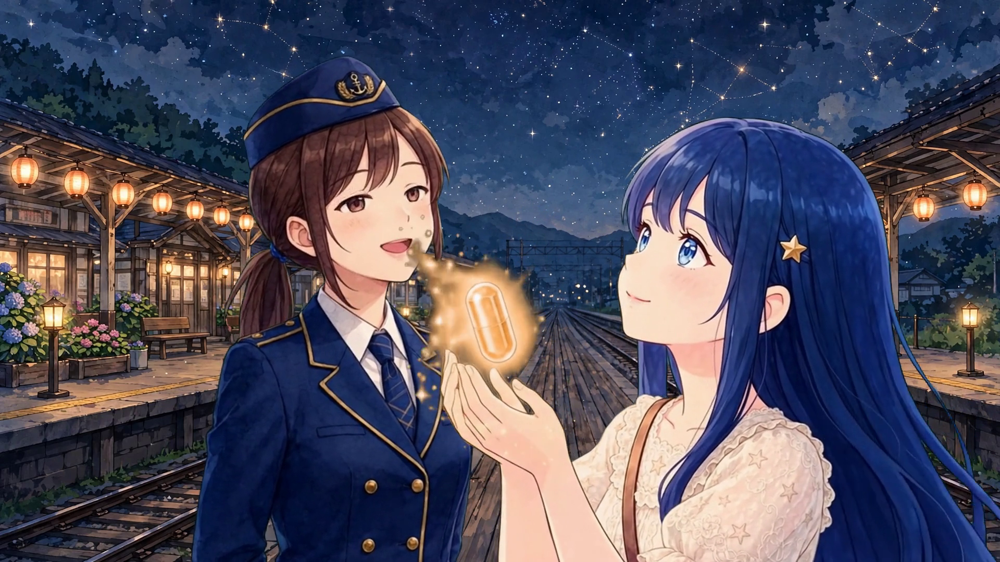
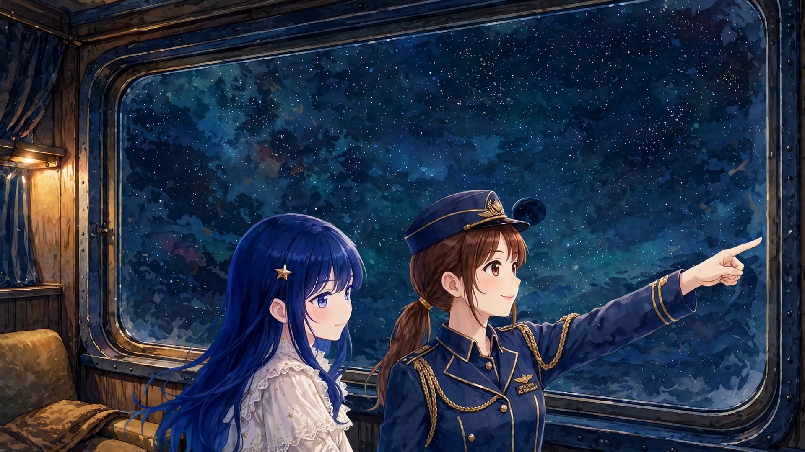
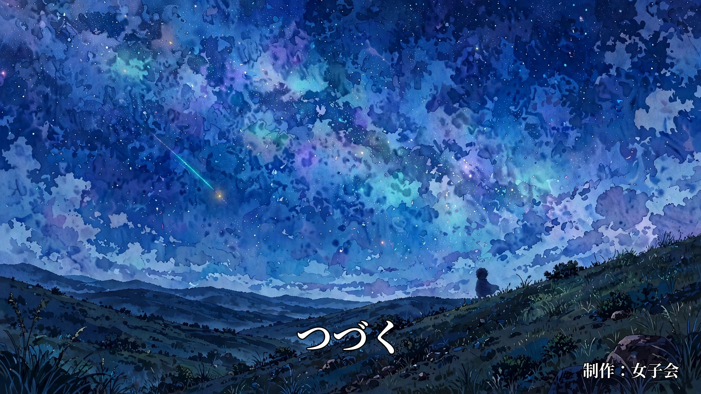

# 星海鉄道アニメ制作ツール（レイヤー方式）/ Seihai Animation Production Tool (Layered Method)

Version 1.0

このツールで作った第1話の画面です / Frames from Episode 1, assembled with this tool:







---

## 日本語

### これは何ですか

アニメーションの「撮影（合成）」だけを行う、小さな制作ツールです。

昔ながらのセルアニメの作り方——**背景と人物を切り離し、人物は動画として別に描き、最後に「撮影」の段階で重ねる**——を、コンピューター上で行います。

用意された素材を、場面表（スペックJSON）の指定どおりに組み立てて、1話分（1920×1080 / 30fps / H.264 + AAC のMP4）に仕上げます。

**正直にお伝えします。このツールは、絵や動画を生成しません。**
背景の絵、緑背景で撮った人物の動画、声の音声は、使う方がご自分の道具（AI生成ツールや動画編集ソフトなど）で用意するものです。このツールが行うのは、その素材の「重ね撮影」と組み立てだけです。画面（GUI）もありません。コマンドラインで動かします。

### 作った人

- 企画・監修：岡崎幸雄
- 監督・制作：Muse と女子会

家族アニメ『星海鉄道カプセル便』（学校も図書館もない星へ、知識のカプセルを届ける列車の物語）の制作で実際に使い、第1話で実証した方式を、誰でも使える形にまとめたものです。

### なぜ無料ですか

学校も、制作スタジオもない場所にいる子どもや作り手を含めて、**世界の誰もが、自分の物語を作って届けられるように**するためです。

お金も、アカウントも、いりません。ダウンロードすれば、ネットにつながなくても使えます。

### 必要なもの

- パソコン（Windows / Mac / Linux）
- Python 3
- ffmpeg（ffprobe も含む。動画の組み立てに使います）

インターネット接続は、ダウンロードのときだけ必要です。実行中はオフラインで動きます。

### 使い方

```bash
python3 make_episode.py episode1_spec.json
```

実行すると、スペックの `output` に完成動画が出力され、隣の `stills/` フォルダに確認用の静止画が自動で切り出されます。最後に、場面ごとの実測秒数・総尺・ファイルサイズが表示されます。

付属の `episode1_spec.json` は、第1話の制作で実際に使った場面表の実例です。**ただし、第1話の素材ファイル（背景・人物動画・音声）そのものは、この配布には含まれていません。** ですから、このスペックをそのまま実行しても動画は作れません。書式の見本として読み、ご自分の素材のパスに書き換えてお使いください。

**すぐに試せる見本**として、`sample/` フォルダに、1場面分（第1話・場面5）の素材と見本スペックが入っています。素材つきですので、そのまま実行できます。

```bash
python3 make_episode.py sample/sample_spec.json
```

18秒の動画が `sample/sample_output.mp4` に出来上がります。詳しくは `sample/README_sample.md` をご覧ください。

### スペック形式（要点）

パスはすべて「スペックファイルのあるフォルダからの相対パス」で書きます（絶対パスも可）。

話全体：

| フィールド | 必須 | 説明 |
|---|---|---|
| `output` | 必須 | 出力MP4のパス |
| `title` | 任意 | 表示用の題名 |
| `fade_in` / `fade_out` | 任意 | 冒頭・末尾のフェード秒数（既定 0.7 / 1.4） |
| `font` | 任意 | テロップ用フォントのパス（既定は Linux の Noto Serif CJK。他の環境ではご自分のフォントを指定してください） |
| `scenes` | 必須 | 場面の配列（順番どおりに連結されます） |

場面（scenes の各要素）：

| フィールド | 必須 | 説明 |
|---|---|---|
| `duration` | 必須 | 場面の秒数 |
| `background` | 必須 | 背景プレート画像（人物を消した場面絵。人物のいない場面は元の場面絵でもよい） |
| `audio` | 任意 | 場面の音声ファイル。省略すると無音場面。音声は自動で「1秒遅延＋無音パディング、48kHz」に揃えられます |
| `layers` | 任意 | 人物レイヤーの配列。**奥→手前の順**に書きます（後に書いたものが上に重なります） |
| `glow` | 任意 | 光の明滅エフェクト（中心 `x`,`y`、半径 `radius`、色 `color`、不透明度 `opacity`） |
| `telops` | 任意 | テロップの配列（文字 `text`、大きさ `fontsize`、位置 `position`、表示時間帯 `start`/`end` など） |

人物レイヤー（layers の各要素）：

| フィールド | 必須 | 説明 |
|---|---|---|
| `video` | 必須 | 緑背景（#00B140 目安）で撮った人物動画（10秒ほど） |
| `green` | 任意 | クロマキーの緑色（16進数）。省略すると動画の四隅の画素から自動で測ります |
| `scale` | どちらか必須 | 拡大縮小率 k（動画の元サイズ × k で画面に置かれます） |
| `perspective` | どちらか必須 | 遠近法から k を自動計算（下記） |
| `x`, `y` | 必須 | 配置位置（1920×1080画面の左上基準） |

キー設定は実証値で固定です：chromakey similarity 0.12 / blend 0.06 + despill（緑の被り除去）。人物動画はピンポン再生（順方向＋逆方向を連結してループ）で場面の長さまで伸ばされます。

遠近法（perspective）：人物の見かけの大きさは「足（体の基底）が地平線からどれだけ下にあるか」に比例する、という近似で k を自動計算します。

```
k = ref_scale × (feet_y − horizon_y) ÷ (ref_feet_y − horizon_y)
```

`feet_y`（この場面で足が着く位置）、`ref_feet_y` と `ref_scale`（基準の奥行きでの足位置と大きさ）、`horizon_y`（地平線。既定 0）を指定します。遠くの人物ほど自動で小さく、手前ほど大きくなります。

### 新しい話を作る手順

1. **素材を用意する**：背景プレート（場面絵から人物を消した画像）、人物だけを緑背景で描いた絵を動画化したもの、場面ごとの音声。
2. **スペックを書く**：`episode1_spec.json` を複製して、秒数・素材パス・配置を書き換えます。配置と大きさは、元の場面絵で人物がいた位置・大きさに合わせるのが基本です。
3. **実行する**：`python3 make_episode.py <スペック>`。
4. **静止画を確認する**：`stills/` の静止画で、人物がいるか、緑の縁が残っていないか、大きさと着地位置が遠近と矛盾しないか、テロップが重なっていないかを確かめます。
5. **例外だけ直す**：おかしい場面はスペックの値（配置・k・緑の指定）を直して再実行します。

### 既知の限界

- **人物の配置は、場面ごとに目で確認が必要です。** 大きさの計算補助（遠近法）はありますが、「正しい位置」は場面絵ごとに人が合わせます。
- **人物動画の内部で、絵が流れる（ドリフトする）ことがあります。** 生成した動画の性質によるもので、大きく流れる素材は作り直すのが確実です。
- **色調の自動調整はしません。** 人物と背景の厳密な色合わせ（カラーグレーディング）は行っていません。
- 後ろ姿の場面では口が見えないため、口パクは付けられません。口の見える構図で素材を作るのが基本です。
- 実行結果の表示（サマリー）は日本語です。

### ライセンス

無料で使えます。詳しくは同梱の `LICENSE.txt` をご覧ください。

---

## English

### What is this?

A small production tool that does one job: the **compositing ("shooting") stage** of animation.

It follows the classic cel-animation method — **background and characters are kept separate, the characters are drawn as video layers of their own, and everything is combined at the "shooting" stage** — done on a computer.

You write a scene table (a spec file in JSON), and the tool assembles your prepared assets into one finished episode (MP4, 1920×1080, 30 fps, H.264 + AAC).

**To be honest: this tool does NOT generate images or videos.**
The background art, the character videos shot against a green background, and the voice audio are prepared by you, with your own tools (AI generation tools, video editors, and so on). This tool only does the layered compositing and assembly. There is no graphical interface (GUI); it runs from the command line.

### Who made it

- Planning & supervision: Yukio Okazaki （岡崎幸雄）
- Direction & production: Muse and the Joshikai (the production team)

It is the actual method used and proven on Episode 1 of the family anime *Seihai Railway Capsule Delivery* (*星海鉄道カプセル便*) — the story of a train that delivers capsules of knowledge to planets that have no schools or libraries — packaged so anyone can use it.

### Why is it free?

So that **anyone in the world — including children and creators in places without schools or studios — can make their own stories and deliver them**.

No money, no account. Once downloaded, it works completely offline.

### Requirements

- A computer (Windows / Mac / Linux)
- Python 3
- ffmpeg (including ffprobe; used to assemble the video)

An internet connection is needed only to download. The tool itself runs offline.

### How to use

```bash
python3 make_episode.py episode1_spec.json
```

The finished video is written to the `output` path in the spec, and check stills are automatically extracted into a `stills/` folder next to it. At the end, the tool prints each scene's measured duration, the total length, and the file size.

The included `episode1_spec.json` is the real scene table used for Episode 1. **However, the Episode 1 asset files themselves (backgrounds, character videos, audio) are NOT included in this distribution**, so that spec will not produce a video as-is. Please read it as a worked example of the format, and replace the paths with your own assets.

**A ready-to-run sample** is included in the `sample/` folder: the assets and spec for one scene (Episode 1, Scene 5), with the assets bundled, so it runs as-is:

```bash
python3 make_episode.py sample/sample_spec.json
```

An 18-second video is written to `sample/sample_output.mp4`. See `sample/README_sample.md` for details.

### Spec format (summary)

All paths are relative to the folder containing the spec file (absolute paths also work).

Episode level:

| Field | Required | Description |
|---|---|---|
| `output` | yes | Path of the output MP4 |
| `title` | no | Title shown in the summary |
| `fade_in` / `fade_out` | no | Fade seconds at the start / end (default 0.7 / 1.4) |
| `font` | no | Path to a font for on-screen text (telops). The default is a Linux Noto Serif CJK path; on other systems, set your own font |
| `scenes` | yes | Array of scenes, joined in order |

Scene level:

| Field | Required | Description |
|---|---|---|
| `duration` | yes | Scene length in seconds |
| `background` | yes | Background plate image (the scene art with characters removed; for scenes without characters, the scene art itself) |
| `audio` | no | Audio file for the scene. Omit for a silent scene. Audio is automatically aligned (1-second delay + silence padding, 48 kHz) |
| `layers` | no | Character layers, listed **far to near** (later entries are drawn on top) |
| `glow` | no | A pulsing light effect (center `x`,`y`, `radius`, `color`, `opacity`) |
| `telops` | no | On-screen text items (`text`, `fontsize`, `position`, `start`/`end`, etc.) |

Character layer level:

| Field | Required | Description |
|---|---|---|
| `video` | yes | Character video shot against a green background (around #00B140), about 10 seconds |
| `green` | no | Chroma-key green as a hex value. If omitted, it is measured automatically from the video's corner pixels |
| `scale` | one of the two | Scale factor k (the video is placed at original size × k) |
| `perspective` | one of the two | Compute k automatically from perspective (below) |
| `x`, `y` | yes | Position on the 1920×1080 frame, from the top-left |

Key settings are fixed at the proven values: chromakey similarity 0.12 / blend 0.06 + despill (green spill removal). Character videos are looped with ping-pong playback (forward + reverse) to fill the scene length.

Perspective: a character's apparent size is approximated as proportional to how far below the horizon their feet (the base of the body) rest:

```
k = ref_scale × (feet_y − horizon_y) ÷ (ref_feet_y − horizon_y)
```

You give `feet_y` (where the feet land in this scene), `ref_feet_y` and `ref_scale` (the feet position and scale at a reference depth), and `horizon_y` (default 0). Characters farther away automatically become smaller; nearer ones, larger.

### Workflow for a new episode

1. **Prepare the assets**: background plates (scene art with the characters removed), videos of each character drawn alone on a green background, and one audio file per scene.
2. **Write the spec**: copy `episode1_spec.json` and replace the durations, asset paths, and placements. As a rule, match each character's position and size to where they stood in the original scene art.
3. **Run it**: `python3 make_episode.py <your spec>`.
4. **Check the stills**: in `stills/`, confirm that each character is present, no green fringe remains, sizes and foot positions agree with the perspective, and text items do not overlap.
5. **Fix only the exceptions**: adjust the spec values (position, k, green) for any scene that looks wrong, and run again.

### Known limits

- **Character placement still needs visual checking, scene by scene.** The perspective formula helps compute size, but the "right" position is fitted by eye against each scene's art.
- **Character videos may drift internally.** This comes from how the videos are generated; material that drifts a lot is best remade.
- **No automatic color grading.** Character tones are used as generated; they are not strictly matched to the background plates.
- In scenes shot from behind, mouths are not visible, so lip-sync cannot be applied. Prepare assets in compositions where the mouth can be seen.
- The run summary printed by the tool is in Japanese.

### License

Free to use. See the included `LICENSE.txt`.

---

企画・監修：岡崎幸雄 / 監督・制作：Muse と女子会
Planning & supervision: Yukio Okazaki / Direction & production: Muse and the Joshikai
