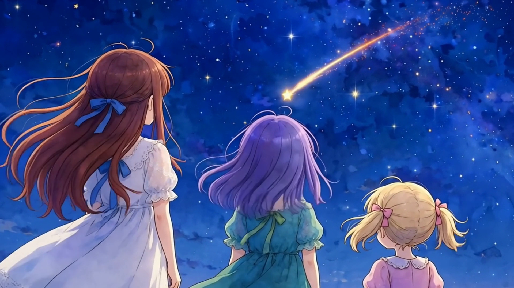
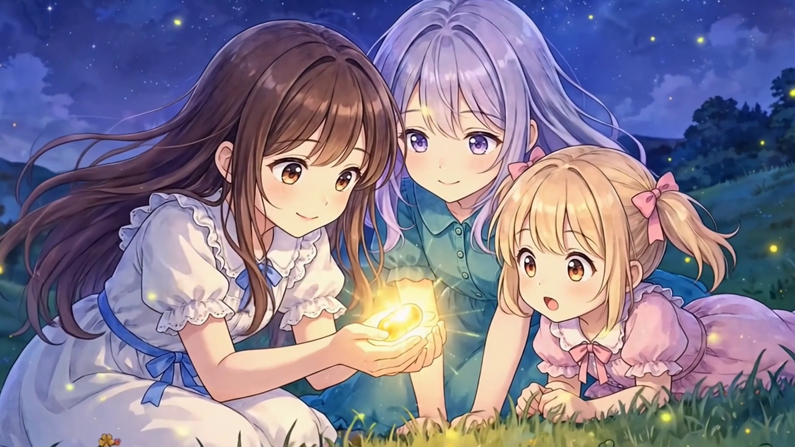
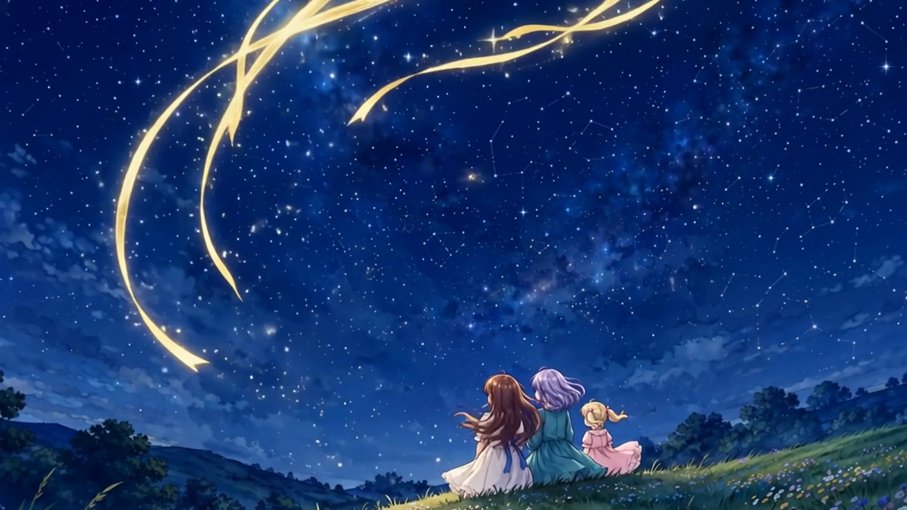

# 星海鉄道アニメ制作ツール（フルアニメ方式）/ Seihai Animation Production Tool (Full-Animation Method)

Version 2.0

このツールで作った短編の画面です / Frames from the short film assembled with this tool:







---

## 日本語

### これは何ですか

アニメーションの「組み立て」だけを行う、小さな制作ツールです。

**フルアニメ方式**——場面絵をそのまま動画化した「場面動画」を、場面表（スペックJSON）の指定どおりに繋いで、1本の完成動画（1920×1080 / 30fps / H.264 のMP4）に仕上げます。

場面動画の解像度やフレームレートが場面ごとに違っていても、ツールが自動で大きさ（画面を覆うまで拡大＋中央クロップ）とフレームレートを揃えます。場面ごとに音声を載せることもできます（シリーズ本編用）。

**正直にお伝えします。このツールは、絵や動画を生成しません。**
場面絵、場面動画、声の音声は、使う方がご自分の道具（AI生成ツールや動画編集ソフトなど）で用意するものです。このツールが行うのは、その素材の正規化と組み立てだけです。画面（GUI）もありません。コマンドラインで動かします。

### 作った人

- 企画・監修：岡崎幸雄
- 監督・制作：Muse と女子会

家族アニメ『星海鉄道カプセル便』（学校も図書館もない星へ、知識のカプセルを届ける列車の物語）の制作で生まれたツールです。Version 2.0 の方式は、短編『星降る丘の少女たち　星の光の中で、愛は生きる』（2026-11-20公開）で実証しました。

### Version 1.0 からの変更（方式の変更）

Version 1.0 は「重ね撮影方式」でした。背景プレート（人物を消した場面絵）と緑背景の人物動画を別々に用意し、クロマキーで抜いて「撮影」の段階で重ねる、昔ながらのセルアニメの作り方です。第1話はその方式で作りました。

しかし実際に作る中で、重ね撮影は段取りが多く、失敗の箇所も多いことが分かりました。人物の配置・大きさ・遠近を場面ごとに手で合わせ続けなければならず、生成した人物動画の内部の寄り・流れで体が切れたり、緑の抜け残りが出たりしました。

それに対してフルアニメ方式は、場面絵をそのまま動画にするため段取りが少なく、短編で安定して作れることを確認できました。そこで監修の判断で、Version 2.0 からフルアニメ方式を正式な方式にしました。

旧方式の道具一式は `legacy/` フォルダに「旧方式」として残してあります。詳しくは `legacy/README_legacy.md` をご覧ください。

### なぜ無料ですか

学校も、制作スタジオもない場所にいる子どもや作り手を含めて、**世界の誰もが、自分の物語を作って届けられるように**するためです。

お金も、アカウントも、いりません。ダウンロードすれば、ネットにつながなくても使えます。

### 必要なもの

- パソコン（Windows / Mac / Linux）
- Python 3
- ffmpeg（ffprobe も含む。動画の組み立てに使います）

インターネット接続は、ダウンロードのときだけ必要です。実行中はオフラインで動きます。

### 使い方

```bash
python3 make_full.py starhill_spec.json
```

実行すると、スペックの `output` に完成動画が出力され、隣の `stills/` フォルダに確認用の静止画が自動で切り出されます。最後に、場面ごとの実測秒数・総尺・ファイルサイズが表示されます。場面の秒数が目標から 0.15 秒以上ずれた場合はエラーで止まります。

付属の `starhill_spec.json` は、短編『星降る丘の少女たち』の制作で実際に使った場面表の実例です。**ただし、場面動画そのものは、この配布には含まれていません**（場面1だけ、下記の見本に入っています）。書式の見本として読み、ご自分の素材のパスに書き換えてお使いください。

**すぐに試せる見本**として、`sample_full/` フォルダに、場面1分の素材（生成したままの未加工の場面動画）と見本スペックが入っています。そのまま実行できます。

```bash
python3 make_full.py sample_full/sample_full_spec.json
```

10秒の動画が `sample_full/sample_full_output.mp4` に出来上がります。詳しくは `sample_full/README_sample_full.md` をご覧ください。

### スペック形式（要点）

パスはすべて「スペックファイルのあるフォルダからの相対パス」で書きます（絶対パスも可）。

話全体：

| フィールド | 必須 | 説明 |
|---|---|---|
| `output` | 必須 | 出力MP4のパス |
| `title` | 任意 | 表示用の題名 |
| `fade_in` / `fade_out` | 任意 | 冒頭・末尾のフェード秒数（既定 0.7 / 1.4）。話全体に一度だけ付きます |
| `font` | 任意 | テロップ用フォントのパス（既定は Linux の Noto Serif CJK。他の環境ではご自分のフォントを指定してください） |
| `scenes` | 必須 | 場面の配列（順番どおりに連結されます） |

場面（scenes の各要素）：

| フィールド | 必須 | 説明 |
|---|---|---|
| `video` | 必須 | 場面動画（場面絵を動画化したもの）。解像度・フレームレートは場面ごとに違ってよい |
| `duration` | 必須 | 場面の秒数。場面動画が短い場合は先頭からループして埋め、長い場合は切ります |
| `name` | 任意 | 場面名（サマリー表示用） |
| `audio` | 任意 | 場面の音声ファイル。省略すると無音場面。音声は自動で「1秒遅延＋無音パディング、48kHz」に揃えられます。1つでも音声のある場面があれば全場面に音声トラックが付き、1つも無ければ完成動画は無音（音声トラックなし）になります |
| `telops` | 任意 | テロップの配列（下記） |

テロップ（telops の各要素）：

| フィールド | 説明 |
|---|---|
| `text` | 表示する文字 |
| `fontsize` | 任意（既定 60） |
| `position` | 任意。`bottom-center`（既定）/ `bottom-right` / `bottom-left` / `top-center` / `top-right` / `top-left` / `center`。または `x`, `y` に drawtext の式を直接書くことも可 |
| `margin_x`, `margin_y` | 任意。端からの余白（既定 60 / 40） |
| `start`, `end` | 任意。表示する時間帯（場面内の秒数。既定は場面全体） |
| `borderw` | 任意。黒縁の太さ（既定 3） |
| `color` | 任意。文字色（既定 white） |

なお、場面動画に音声が含まれていても、その音は使われません。音は `audio` で指定したものだけが載ります。

### 新しい作品を作る手順

1. **素材を用意する**：場面絵を作り、お持ちの道具で場面ごとに動画化します（10秒ほどが目安）。シリーズ本編の場合は、場面ごとの音声も用意します。
2. **スペックを書く**：`starhill_spec.json` を複製して、秒数と素材パスを書き換えます。
3. **実行する**：`python3 make_full.py <スペック>`。
4. **静止画を確認する**：`stills/` の静止画で、構図の切り取られ方やテロップの重なりを確かめます。
5. **例外だけ直す**：おかしい場面は、素材そのものかスペックの秒数を直して再実行します。

### 既知の限界（正直にお伝えします）

- **生成動画の解像度がまちまちだと、画質が柔らかくなります。** 小さい動画（例：1152×768）を 1920×1080 に拡大するため、元絵と比べて縁が一部切り取られ、全体に柔らかい画質になります。短編『星降る丘の少女たち』でもそのまま出ています。元動画を大きく作れる道具では、その分はっきりします。
- **カメラの寄り・引きは、生成任せになります。** 場面動画の中でカメラが寄ったり引いたりするのは、動画を作る道具の性質です。このツールは構図を後から直せません（切り取る位置は中央固定です）。
- **場面のつなぎはカットだけです。** 場面と場面の間に溶暗などのつなぎ効果はなく、全体の冒頭と末尾のフェードだけが付きます。
- **場面動画が場面の秒数より短い場合、先頭からループして埋めます。** 動きのつなぎ目が見えることがあります。場面の秒数は、場面動画の長さに合わせるのが基本です。
- **色調の自動調整はしません。** 場面ごとの色の違いは、素材のまま出ます。
- 実行結果の表示（サマリー）は日本語です。

### ライセンス

無料で使えます。詳しくは同梱の `LICENSE.txt` をご覧ください。

---

## English

### What is this?

A small production tool that does one job: **assembling** an animated work.

It uses the **full-animation method**: each scene picture is animated as-is into a "scene video", and the tool joins those videos, following a scene table (a spec file in JSON), into one finished video (MP4, 1920×1080, 30 fps, H.264).

Even if your scene videos differ in resolution or frame rate from scene to scene, the tool normalizes them automatically (scale to cover the frame + center crop, and frame-rate conversion). A voice/audio file can be attached to each scene (for series episodes).

**To be honest: this tool does NOT generate images or videos.**
The scene art, the scene videos, and the voice audio are prepared by you, with your own tools (AI generation tools, video editors, and so on). This tool only normalizes and assembles them. There is no graphical interface (GUI); it runs from the command line.

### Who made it

- Planning & supervision: Yukio Okazaki （岡崎幸雄）
- Direction & production: Muse and the Joshikai (the production team)

The tool grew out of the family anime *Seihai Railway Capsule Delivery* (*星海鉄道カプセル便*) — the story of a train that delivers capsules of knowledge to planets that have no schools or libraries. The Version 2.0 method was proven on the short film *Girls on the Starfall Hill* (released 2026-11-20).

### What changed from Version 1.0 (a change of method)

Version 1.0 used the **layered method**: background plates (scene art with the characters removed) and character videos shot against a green background were prepared separately, keyed, and combined at the "shooting" stage — the classic cel-animation way. Episode 1 was made that way.

But making it showed that the layered method has many steps and many failure points: every scene needed its characters' position, size, and perspective fitted by hand; generated character videos drifted or zoomed inside themselves and clipped bodies; green fringes remained.

The full-animation method animates each scene picture as-is, so it has far fewer steps, and it proved stable on the short film. By the supervisor's decision, from Version 2.0 the full-animation method is the official method.

The Version 1.0 toolset is kept in the `legacy/` folder, clearly marked as the legacy method. See `legacy/README_legacy.md`.

### Why is it free?

So that **anyone in the world — including children and creators in places without schools or studios — can make their own stories and deliver them**.

No money, no account. Once downloaded, it works completely offline.

### Requirements

- A computer (Windows / Mac / Linux)
- Python 3
- ffmpeg (including ffprobe; used to assemble the video)

An internet connection is needed only to download. The tool itself runs offline.

### How to use

```bash
python3 make_full.py starhill_spec.json
```

The finished video is written to the `output` path in the spec, and check stills are automatically extracted into a `stills/` folder next to it. At the end, the tool prints each scene's measured duration, the total length, and the file size. If a scene's length deviates from its target by 0.15 seconds or more, the tool stops with an error.

The included `starhill_spec.json` is the real scene table used for the short film *Girls on the Starfall Hill*. **However, the scene videos themselves are NOT included in this distribution** (only Scene 1, in the sample below). Please read it as a worked example of the format, and replace the paths with your own assets.

**A ready-to-run sample** is included in the `sample_full/` folder: the raw, unprocessed scene video for Scene 1 and a sample spec, so it runs as-is:

```bash
python3 make_full.py sample_full/sample_full_spec.json
```

A 10-second video is written to `sample_full/sample_full_output.mp4`. See `sample_full/README_sample_full.md` for details.

### Spec format (summary)

All paths are relative to the folder containing the spec file (absolute paths also work).

Work level:

| Field | Required | Description |
|---|---|---|
| `output` | yes | Path of the output MP4 |
| `title` | no | Title shown in the summary |
| `fade_in` / `fade_out` | no | Fade seconds at the start / end (default 0.7 / 1.4), applied once to the whole video |
| `font` | no | Path to a font for on-screen text (telops). The default is a Linux Noto Serif CJK path; on other systems, set your own font |
| `scenes` | yes | Array of scenes, joined in order |

Scene level:

| Field | Required | Description |
|---|---|---|
| `video` | yes | The scene video (the scene picture, animated). Resolution and frame rate may differ per scene |
| `duration` | yes | Scene length in seconds. A shorter scene video is looped from the start to fill; a longer one is cut |
| `name` | no | Scene name (shown in the summary) |
| `audio` | no | Audio file for the scene. Omit for a silent scene. Audio is automatically aligned (1-second delay + silence padding, 48 kHz). If at least one scene has audio, every scene gets an audio track; if none do, the finished video is silent (no audio track) |
| `telops` | no | On-screen text items (below) |

Telop items:

| Field | Description |
|---|---|
| `text` | The text to show |
| `fontsize` | Optional (default 60) |
| `position` | Optional. `bottom-center` (default) / `bottom-right` / `bottom-left` / `top-center` / `top-right` / `top-left` / `center`. Or give drawtext expressions directly in `x`, `y` |
| `margin_x`, `margin_y` | Optional. Margins from the edges (default 60 / 40) |
| `start`, `end` | Optional. Time window within the scene (default: the whole scene) |
| `borderw` | Optional. Black outline width (default 3) |
| `color` | Optional. Text color (default white) |

Note: audio contained in a scene video itself is never used. Only audio named by `audio` is attached.

### Workflow for a new work

1. **Prepare the assets**: make the scene pictures, and animate each one into a scene video with your own tool (about 10 seconds each is a good guide). For series episodes, also prepare one audio file per scene.
2. **Write the spec**: copy `starhill_spec.json` and replace the durations and asset paths.
3. **Run it**: `python3 make_full.py <your spec>`.
4. **Check the stills**: in `stills/`, confirm how each frame was cropped and that text items do not overlap.
5. **Fix only the exceptions**: for any scene that looks wrong, fix the asset itself or the duration in the spec, and run again.

### Known limits (stated honestly)

- **If the generated videos have mixed resolutions, the picture gets softer.** A small video (e.g. 1152×768) is enlarged to 1920×1080, so edges are partly cropped and the image is softer than the source art. This is visible in *Girls on the Starfall Hill* itself. Tools that generate larger videos give a sharper result.
- **Camera moves are up to the generator.** If the camera pushes in or pulls out inside a scene video, that is a property of the video-making tool. This tool cannot correct composition afterwards (cropping is fixed at the center).
- **Scenes are joined by cuts only.** There are no transitions between scenes; only the opening and closing fades of the whole video are applied.
- **A scene video shorter than its scene is looped from the start to fill.** The seam of the loop may be visible. As a rule, match each scene's duration to its video's length.
- **No automatic color grading.** Color differences between scenes appear as they are in the assets.
- The run summary printed by the tool is in Japanese.

### License

Free to use. See the included `LICENSE.txt`.

---

企画・監修：岡崎幸雄 / 監督・制作：Muse と女子会
Planning & supervision: Yukio Okazaki / Direction & production: Muse and the Joshikai
